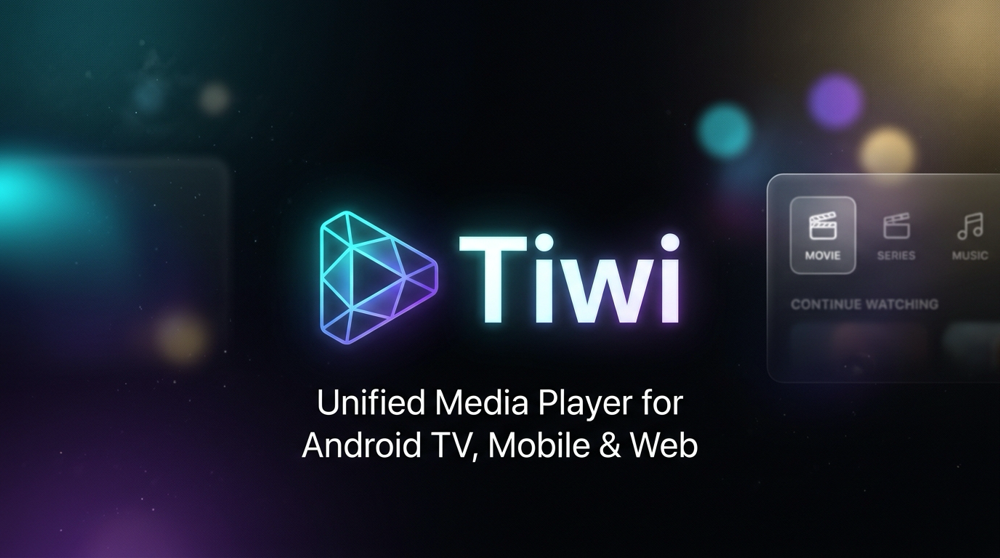
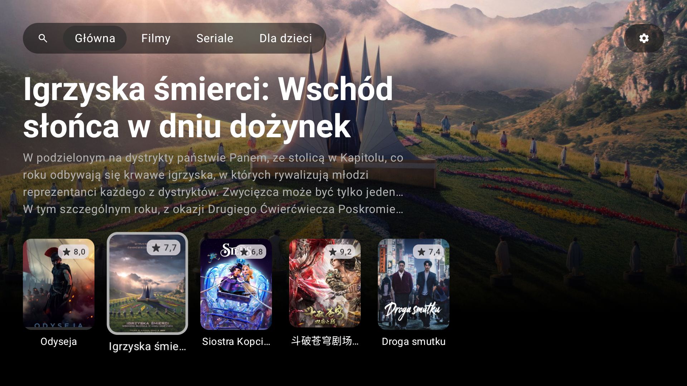
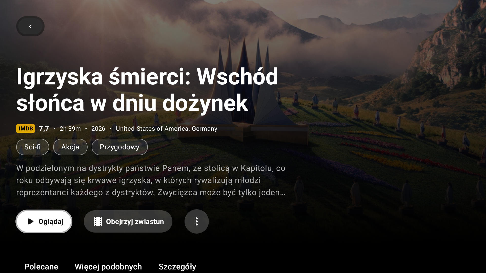
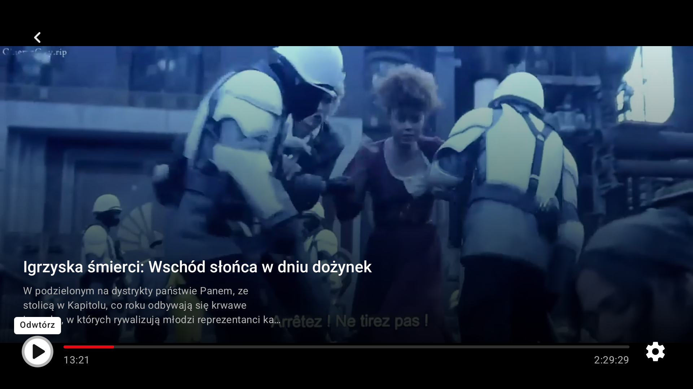
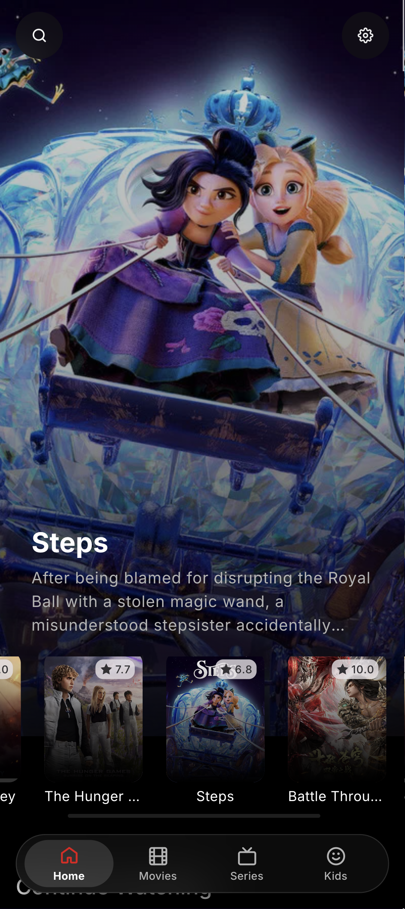
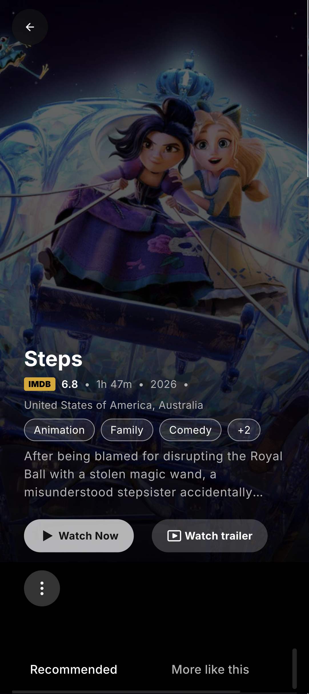
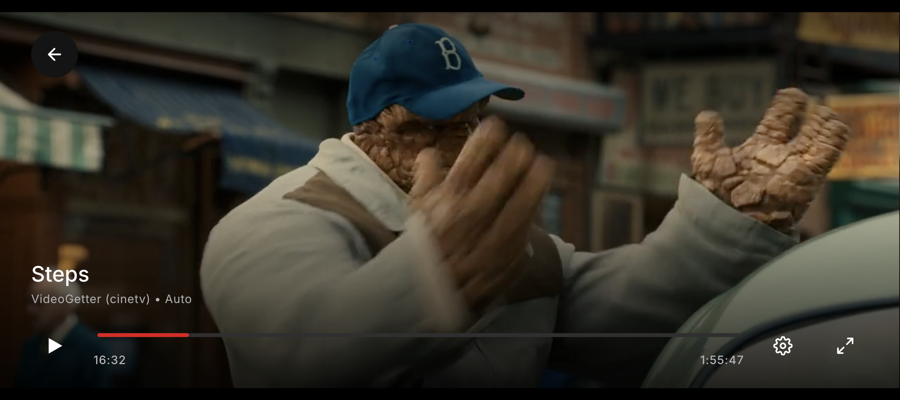
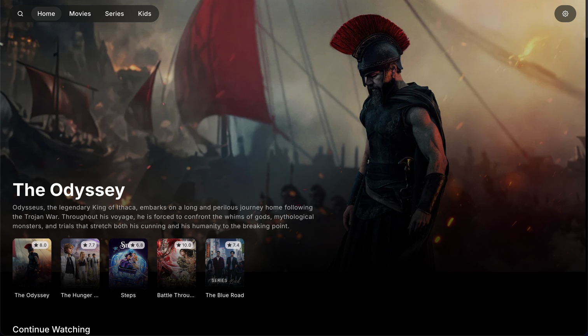
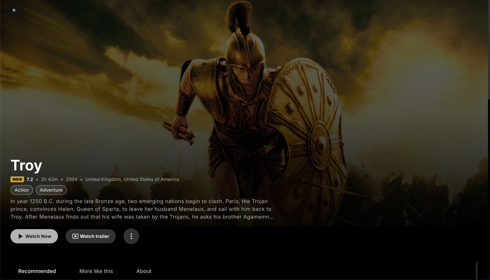
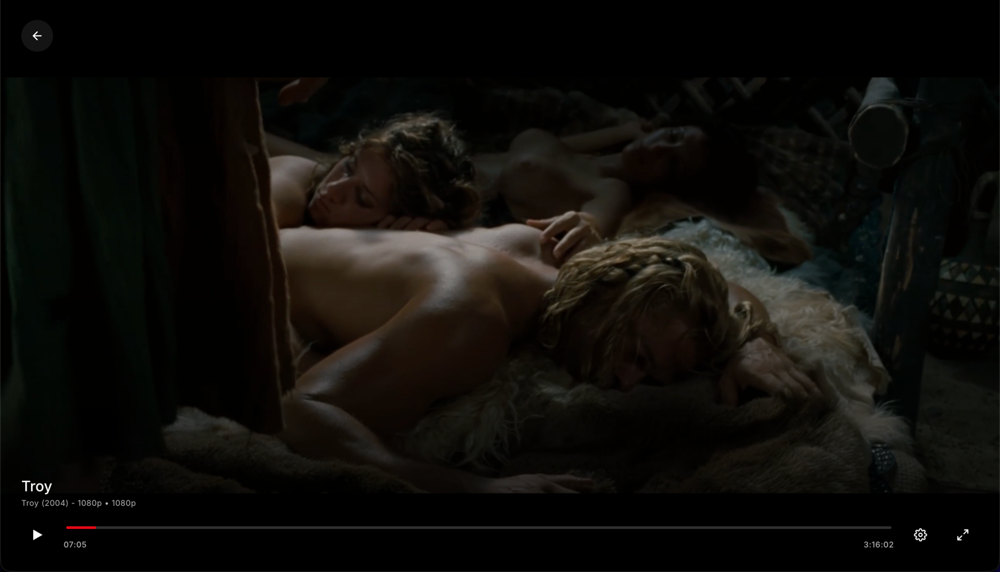

# Tiwi 🎬

<p align="center">
  
</p>

<p align="center">
  <b>A unified, cross-platform media client and streaming interface for Android TV, Mobile, and Web.</b>
</p>

<p align="center">
  
  
  
  
  
  
</p>

---

## ⚠️ Legal Disclaimer & Terms of Use

> [!CAUTION]
> **PLEASE READ THIS SECTION CAREFULLY BEFORE USING, FORKING, OR DEPLOYING THIS SOFTWARE.**

1. **Non-Hosting & Content Disclaimer**:  
   This software is an open-source, non-commercial educational project designed as a client-side interface and media player frontend. **This software does not host, store, archive, upload, or transmit any video files, movies, episodes, or copyrighted media.** All metadata, posters, descriptions, and ratings are sourced independently through public APIs (such as [The Movie Database - TMDB](https://www.themoviedb.org/)).

2. **Third-Party Hyperlinks & External Resolvers**:  
   Any media streams or playback capabilities rely exclusively on third-party, publicly available external web links and hosters. The authors and maintainers of this repository:
   - Do not control, operate, or maintain any video hosting servers or stream providers.
   - Have no affiliation, partnership, or commercial relationship with third-party providers.
   - Make no representations or warranties regarding the legality, safety, or licensing of any external links.

3. **No Financial Gain**:  
   This project is completely free, non-monetized, and open-source. There are no subscriptions, ads, affiliate programs, donations, or commercial sales associated with this software.

4. **Limitation of Liability**:  
   The authors and contributors **expressly disclaim any and all liability or responsibility** for:
   - Any copyright infringement, intellectual property claims, or legal issues arising from the use, configuration, or deployment of this software.
   - How end-users choose to configure stream endpoints, API resolvers, or external plugins.
   - Any violations of local laws, network regulations, or third-party Terms of Service.
   
   **By using or compiling this software, you acknowledge and agree that you are solely responsible for ensuring that your usage complies with all applicable local, national, and international laws and copyright regulations.**

---

## 📱 Visual Showcase & Form Factors

Tiwi provides a shared design language tailored to each specific device form factor:

### 📺 Android TV (10-Foot Leanback Experience)
*Designed specifically for directional D-pad remotes with smooth focus transitions, pulse indicators, and custom TV screensaver.*

| Android TV - Home | Android TV - Media Details | Android TV - Advanced Player |
| :---: | :---: | :---: |
|  |  |  |

### 📱 Android Mobile & Tablet
*Touch-optimized declarative Jetpack Compose UI with adaptive gestures, mobile navigation bar, and responsive layouts.*

| Mobile - Home | Mobile - Details | Mobile - Video Player |
| :---: | :---: | :---: |
|  |  |  |

### 🌐 Modern Web Client (`/web`)
*High-performance Single Page Application (SPA) built with React 18, Vite, and Node.js. Features full keyboard/remote navigation, mouse-hover preview cards, and authenticated HTTP routing.*

| Web - Desktop Catalog | Web - In-Depth Details | Web - Player & Audio Lektor |
| :---: | :---: | :---: |
|  |  |  |

*(To add your own screenshots, place `.png` images in the `docs/images/` directory matching the names above).*

---

## ✨ Features

- **Cross-Platform Parity**: Full feature parity between native Android (Kotlin) and Web (React). UI interactions and player algorithms stay strictly synchronized.
- **Rich Media Catalog**: Browse Trending, Popular, Top Rated, and Newly Released Movies and TV Series with TMDB metadata, actor filmographies, genres, and recommendations.
- **Family & Kids Mode**: Dedicated, safe "For Kids" section curated for family-friendly viewing with child certification filters.
- **Multi-Source Playback Engine**:
  - Android: Native player built on top of **Jetpack Media3 (ExoPlayer)** with adaptive HLS/MP4 streaming, audio track selection, and hardware decoding.
  - Web: Custom HTML5/HLS player with keyboard seeking, aspect-ratio controls, and buffer monitoring.
- **Intelligent Subtitle Ranking & Synchronization**:
  - Direct integration with OpenSubtitles and Wyzie via TMDB ID and filename heuristic matching.
  - Automatic identification of hearing-impaired (SDH), forced-only, and language-specific tracks.
  - Subtitle alignment using rasterized cross-correlation analysis (`BIN_MS = 100`) to detect and eliminate timing drift.
- **Lektor (AI & Offline Polish Voice-Over)**:
  - Synchronous text-to-speech voice-over synthesized directly over subtitles.
  - Offline support via Android system TTS voices (zero network overhead).
  - Neural AI voices (Marek & Zofia) with calm speech processing, rate auto-adjustment, and smart sentence boundary merging.
  - Audio ducking with configurable timing offsets and subtitle hiding.
- **Cross-Device User Accounts & Cloud Sync**:
  - Self-hosted PostgreSQL backend (`tmdb_sync`).
  - Seamlessly synchronizes watch history, resume timestamps, watchlist, favorites, and settings across Android TV, phone, and browser.
- **Secure & Private Deployment**:
  - HTTP Basic Auth & Token Auth router protecting web access.
  - Persistent cryptographically signed session cookies (`HMAC-SHA256`) surviving page reloads for 30 days.
  - Backend Stream API isolated with secret key authentication (`X-Api-Key`).

---

## 🔄 Dual-Platform Architecture Parity

Android TV and Web (`/web`) are engineered to maintain strict algorithmic and domain parity:

1. **Shared Domain Logic**: Subtitle ranking heuristics, video signature extraction, cue parsing, and Lektor speech synthesis share identical math and rules across Kotlin (`core:data`, `core:player`) and JavaScript (`web/src/data/`, `web/src/player/`).
2. **Platform UX Enhancements**:
   - **Web / Desktop**: Mouse hover cards, wheel-based seeking, browser back/popstate history, and fluid responsive grid layouts.
   - **Android TV / Leanback**: Spatial D-pad navigation, focus pulse halos (`selectablePulse`), Leanback launcher banners, and ambient screensaver integration.
3. **Rigorous Test Coverage**: Both suites test identical logic (`./gradlew testDebugUnitTest` and `cd web && npm test`).

---

## 🛠️ Tech Stack

### Android Client
- **Language**: Kotlin 2.0 (Coroutines, Flow, StateFlow)
- **UI Toolkit**: Jetpack Compose & Compose for TV
- **Media Player**: Jetpack Media3 / ExoPlayer
- **Dependency Injection**: Koin
- **Networking**: OkHttp 4, Kotlinx Serialization
- **Image Loading**: Coil Compose

### Web Client (`/web`)
- **Frontend Framework**: React 18, Vite 6
- **Backend Router**: Native Node.js 20 HTTP router (`server.js`)
- **State Management**: Lightweight observable persisted stores
- **Security**: HMAC-SHA256 signed session cookies, Basic Auth, Bearer Token Auth

### Self-Hosted Backend & Sidecars
- **Stream API**: Multi-provider resolver microservice
- **Database**: PostgreSQL 16 Alpine (`tmdb_sync`)
- **Containerization**: Docker & Docker Compose with health checks

---

## 🚀 Getting Started

### 1. Android Client Build

**Prerequisites**:
- [Android Studio Ladybug (2024.2.1+)](https://developer.android.com/studio)
- JDK 17
- Android SDK 35+

1. Clone the repository:
   ```bash
   git clone https://github.com/pChochura/Filman.cc.git
   cd Filman.cc
   ```
2. Configure your stream API in `local.properties`:
   ```properties
   STREAM_API_BASE_URL=http://<YOUR_SERVER_IP>:8787
   STREAM_API_KEY=<YOUR_API_SECRET_KEY>
   ```
3. Build and install:
   ```bash
   ./gradlew assembleDebug
   # Or run directly on your connected TV / emulator via Android Studio
   ```

### 2. Self-Hosted Server & Web App Deployment

The entire backend and web client can be deployed with Docker Compose:

1. Copy and configure the environment variables:
   ```bash
   cd web
   cp .env.example .env
   # Edit .env and supply your TMDB_API_KEY, STREAM_API_KEY, and router credentials
   ```
2. Start the services:
   ```bash
   docker compose up -d --build
   ```
3. Access your web app in your browser:
   ```
   http://<SERVER_IP>
   ```

---

## 🧪 Testing

Run test suites across both platforms:

```bash
# Android Unit Tests (300+ tests)
./gradlew testDebugUnitTest

# Web Client Tests (32 tests)
cd web && npm test
```

---

## 🚀 Release & Deployment

Tiwi enforces dual-platform version alignment and automated deployment. See [GEMINI.md](GEMINI.md) for full instructions.

### 1. Synchronized Version Bumping
Both platforms must always be bumped in lockstep:
```bash
./scripts/bump_version.sh
```

### 2. Publish Android App
Build and publish the release App Bundle to Google Play Internal Testing:
```bash
./scripts/publish_internal.sh --build -n "Release notes"
```

### 3. Deploy Web App via SSH
Deploy the web client to the production server:
```bash
./scripts/deploy_web.sh
```

---

## 🤝 Contributing

Contributions, feedback, and bug reports are welcome via [GitHub Issues](https://github.com/pChochura/Filman.cc/issues).  
When contributing, please follow the **Zero Hardcoded Text** rule: all user-facing strings must be localized in `strings.xml` (English and Polish).

---

## 📝 License

This project is licensed under the **MIT License** - see the [LICENSE](LICENSE) file for details.
