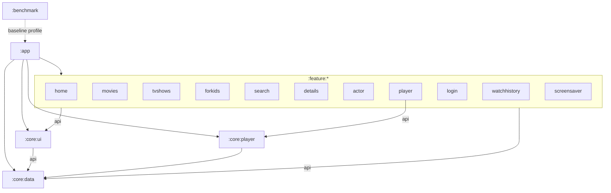
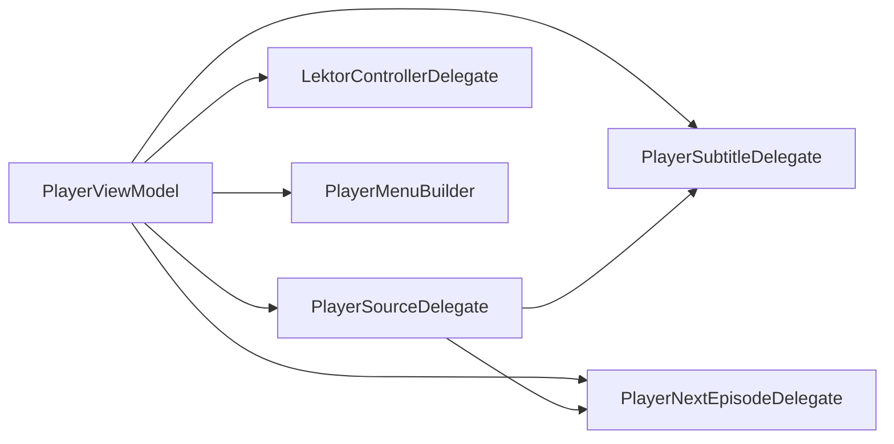
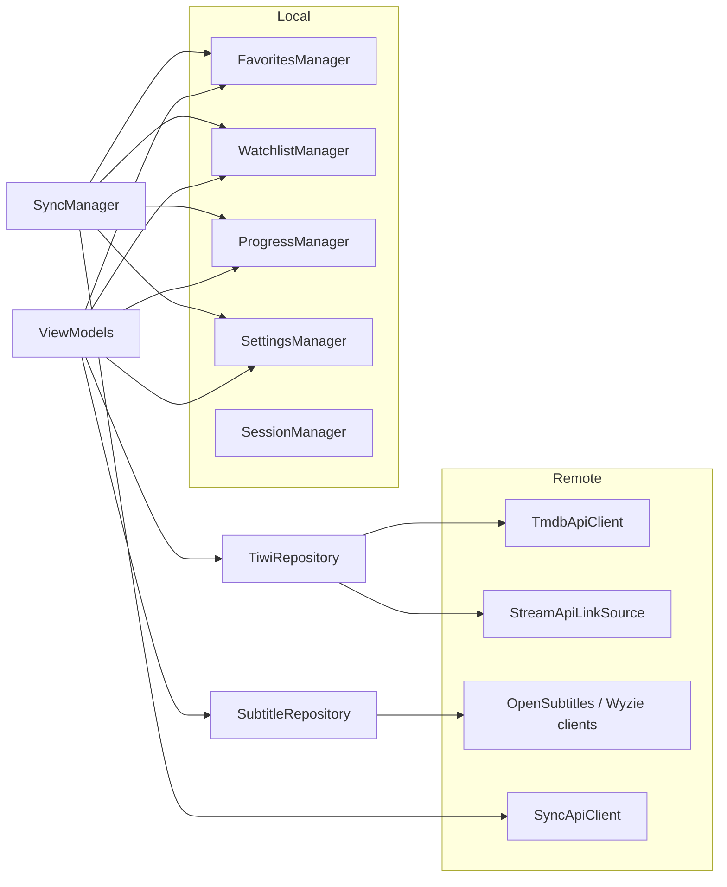

# Tiwi — Architecture Guidelines

This document describes **how Tiwi is built today** and the rules new code must follow to stay
consistent with it. It is descriptive first (derived from the current codebase) and prescriptive
second. When the code and this document disagree, fix one of them in the same change.

Companion document: [DESIGN_SYSTEM.md](DESIGN_SYSTEM.md) (visual language, components, TV focus UX).

---

## 1. Guiding principles

1. **TV-first, D-pad-first.** Every screen must be fully operable with a remote (D-pad, OK, Back,
   Menu). Touch is a secondary input. Focus behaviour is a feature, not an afterthought.
2. **Unidirectional data flow (MVI-style).** `Event → ViewModel → State (+ one-shot Effect) → UI`.
   Composables never mutate data directly.
3. **TMDB-native identity.** Every piece of media is identified by a canonical `MediaRef` key
   (`movie_{id}`, `show_{id}`, `show_{id}_{season}_{episode}`). No scraped/provider URLs as IDs.
4. **Feature isolation.** Feature modules depend only on `:core:*`, never on each other.
   Cross-feature navigation goes through `Route`.
5. **Small, focused units.** Large ViewModels are decomposed into delegates, builders and
   extension files (see §6.4). Keep files under ~350 lines; split before they grow past that.
6. **Fail soft.** Network failures surface as `errorMessage`/empty states with a retry action,
   never as crashes. `CancellationException` is always rethrown.
7. **Dual-platform parity (Android TV & Web).** Tiwi has two official platforms: Android
   (TV & Mobile) and Web (`/web`). Both platforms MUST stay in strict sync. Whenever something
   changes—whether it is a bug fix, new feature, player control, subtitle matching/alignment/ranking,
   Lektor voice-over logic, stream extraction, settings, or UX workflow—**both platforms must ship
   the exact same change together**. Changes must never be applied to one platform in isolation.

---

## 2. Tech stack

| Concern | Choice |
|---|---|
| Language | Kotlin (JVM toolchain 17), Coroutines + Flow |
| UI | Jetpack Compose + **`androidx.tv.material3`** (TV Material) |
| Navigation | Navigation 3 (`NavDisplay`, typed `Route` back stack) |
| DI | Koin 4 (`singleOf`, `viewModelOf`, `koinViewModel()`) |
| Networking | OkHttp (+ MockWebServer in tests), kotlinx.serialization JSON |
| Persistence | DataStore Preferences (JSON-serialized lists/objects) |
| Images | Coil (`AsyncImage`) |
| Playback | Media3 / ExoPlayer (HLS, OkHttp datasource, session), WebView embeds |
| Background | WorkManager (`SyncWorker`, `NewEpisodeWorker`), TV Provider channels |
| Extraction | NewPipe Extractor (YouTube trailers), Jsoup |
| Tests | JUnit4, MockK, Turbine, kotlinx-coroutines-test |
| Perf | Baseline profiles (`:benchmark`), Compose stability config |

SDK levels: `minSdk 24`, `compileSdk`/`targetSdk 37`. All dependency versions live in
[`gradle/libs.versions.toml`](../gradle/libs.versions.toml) — never hardcode versions in module
build files. Prefer existing **bundles** (`androidx-compose`, `androidx-lifecycle`,
`androidx-media3`, `androidx-tv`).

---

## 3. Module structure



### 3.1 Module responsibilities

| Module | Owns | Must NOT contain |
|---|---|---|
| `:app` | `MainActivity`, `TiwiApplication`, Koin graph (`AppModules.kt`), nav graph (`TiwiNavGraph.kt`), app shell (`TiwiApp.kt`), global settings overlay, deep links, WorkManager workers, TV recommendations | Feature screens, reusable components |
| `:core:ui` | Theme & tokens, reusable components, lazy-grid sections, `BaseViewModel` & MVI base types, focus/key utilities, `Route`, **all shared string resources** | Feature-specific logic, network calls |
| `:core:data` | Domain models, TMDB client, stream API client, subtitle clients, local managers (DataStore), sync, mappers, `BuildConfig` secrets | Compose UI, Android Views |
| `:core:player` | Lektor (Polish voice-over) engine: SRT parsing, text normalization, TTS engines, playback controller | UI, navigation |
| `:feature:<name>` | One screen (or tightly-related screen family): `Screen`, `ViewModel`, `Contract`, screen-specific components/helpers | Dependencies on other features, Koin module definitions |
| `:benchmark` | Baseline-profile generator | Production code |

### 3.2 Adding a new feature module

1. Create `feature/<name>/` and `include(":feature:<name>")` in `settings.gradle.kts`.
2. Copy an existing feature `build.gradle.kts` (e.g. `feature/home`) — keep the same plugins,
   `namespace = "com.pointlessapps.filman.ui.<name>"`, `compileSdk`, `minSdk`, JVM 17,
   compose stability file, and dependencies (`api(project(":core:ui"))`, `api(project(":core:data"))`).
3. Package: `com.pointlessapps.filman.ui.<name>`.
4. Add a `Route` subtype in `core/ui/.../Route.kt`.
5. Register the screen with `entry<Route.X> { … }` in `TiwiNavGraph.kt`.
6. Register the ViewModel with `viewModelOf(::XViewModel)` in `AppModules.kt`.
7. Add `implementation(project(":feature:<name>"))` to `app/build.gradle.kts`.
8. Add a test in `AppModulesTest` coverage if the ViewModel has new dependencies.

---

## 4. Package & file conventions

```
com.pointlessapps.filman
├── Route.kt                         (:core:ui)  – navigation destinations
├── config/                          (:core:data) – build/runtime constants
├── data/
│   ├── api/            clients, repositories, mappers, link sources
│   │   ├── dto/        wire models (server/TMDB DTOs)
│   │   ├── tmdb/       TmdbApiClient, TmdbUrlBuilder, TmdbJsonParser, TmdbLocaleProvider
│   │   └── extractors/ YouTube / embed extractors
│   ├── local/          *Manager classes backed by DataStore
│   ├── mapper/         pure mapping functions
│   ├── model/          domain models (MovieItem, MediaRef, DetailedMedia…)
│   ├── recommendation/
│   └── sync/           SyncManager, api/, model/
├── player/lektor/      (:core:player) controller/ engine/ model/ normalizer/ parser/
├── ui/
│   ├── base/           BaseViewModel, BaseEvent, SharedState, helpers
│   ├── components/     Tiwi* components
│   │   └── sections/   LazyGridScope.*Section() builders
│   ├── core/           modifiers, focus, key guards, TextValue, events
│   ├── theme/          Color, Type, Spacing, Theme
│   └── <feature>/      feature packages (in feature modules)
└── utils/
```

### 4.1 File naming inside a feature

| File | Purpose | Example |
|---|---|---|
| `XScreen.kt` | Stateful entry composable + private stateless `XScreenContent` | `HomeScreen.kt` |
| `XContract.kt` | `XEvent`, `XState`, `XEffect` (and screen-local enums/sealed types) | `MovieDetailsContract.kt` |
| `XViewModel.kt` | ViewModel only | `HomeViewModel.kt` |
| `XContent.kt` / `XScreenComponents.kt` | Large chunks of stateless UI split out of the screen | `MovieDetailsContent.kt`, `LoginScreenComponents.kt` |
| `XStateExt.kt` | Pure derivations on state (`internal fun XState.foo()`) | `MovieDetailsStateExt.kt` |
| `X*Delegate.kt` | Focused slice of ViewModel logic | `PlayerSourceDelegate.kt` |
| `X*MenuBuilder.kt` / `*Menu.kt` | Pure builders that produce `OverlayMenuData` | `PlayerMenuBuilder.kt`, `LektorTimingMenu.kt` |
| `XFocusFallbackExt.kt` | Focus fallback rules after list mutations | `HomeFocusFallbackExt.kt` |
| `model/` | Feature-local UI models | `player/model/NextEpisodeButtonModel.kt` |

> **Rule:** New features put `Event`/`State`/`Effect` in `XContract.kt`. (`movies`, `tvshows`
> and `forkids` still declare them inside the ViewModel file — move them when touching those files.)

### 4.2 Naming

- Shared UI components are prefixed `Tiwi` (`TiwiButton`, `TiwiOverlayMenu`) unless they
  are domain-named (`MediaCard`, `SectionHeader`).
- Lazy-grid section builders are lower-camel extension functions ending in `Section`:
  `fun LazyGridScope.moviesRowSection(...)`.
- Local data holders are `*Manager` (`FavoritesManager`), remote clients are `*Client`
  (`TmdbApiClient`), aggregators are `*Repository` (`TiwiRepository`, `SubtitleRepository`).
- Effects that navigate are `NavigateToX`; toasts are `ShowToast(TextValue)`.
- Events are imperative verbs: `LoadHomeData`, `PlayItem`, `ToggleLektor`, `LoadMoreForSection`.

---

## 5. Navigation

- Destinations are a **sealed `Route` hierarchy** (`@Serializable @Parcelize`) in
  [`Route.kt`](../core/ui/src/main/java/com/pointlessapps/filman/Route.kt). Arguments are
  constructor properties (`Route.Details(request, autoPlay, episodeUrl)`).
- Each route declares its chrome: `showNavigationBar` (top tabs) and `showBackButton`
  (back pill instead of tabs). Defaults: tabs shown, no back button.
- The back stack is a `mutableStateListOf<Route>` owned by `MainViewModel`; `NavDisplay`
  renders it with `rememberSaveableStateHolderNavEntryDecorator()` and
  `rememberViewModelStoreNavEntryDecorator()` (each entry gets its own ViewModel store).
- Screens **never** hold a nav controller. They receive `onNavigateTo: (Route) -> Unit` and call it
  from effect collectors:

```kotlin
CollectEffect(viewModel.effect) { effect ->
    when (effect) {
        is HomeEffect.NavigateToDetails ->
            onNavigateTo(Route.Details(effect.request, effect.autoplay, effect.episodeUrl))
        is HomeEffect.NavigateToAuth -> onNavigateTo(Route.Login())
    }
}
```

- `onNavigateTo(null)` means "back". Top-level tab switches go through `MainViewModel.navigateToTab`.
- Before navigating, the app shell moves focus to an invisible 1dp `transitionFocusRequester`
  to avoid focus landing on a disposed node. Don't bypass `handleNavigateTo`.
- Deep links (`filman://details…`) are parsed in `DeepLinkParser` and routed by
  `MainViewModel.handleIntent`.

### 5.1 Screen entry signature

All browsable screens share this signature; keep it:

```kotlin
@Composable
fun XScreen(
    /* route args first */
    onNavigateTo: (Route) -> Unit,
    contentFocusRequester: FocusRequester,
    paddingValues: PaddingValues,          // top inset = navigation bar height
    viewModel: XViewModel = koinViewModel(),
)
```

Full-screen experiences (`PlayerScreen`) may omit `contentFocusRequester`/`paddingValues`.

---

## 6. Presentation layer (MVI)

### 6.1 Contract

```kotlin
sealed interface HomeEvent : TiwiEvent {
    data object LoadHomeData : HomeEvent
    data class LoadMoreForSection(val sectionTitle: Int) : HomeEvent
}

@Immutable
data class HomeState(
    override val shared: SharedState = SharedState(),
    val favorites: List<MovieItem> = emptyList(),
) : StateWithShared<HomeState> {
    override fun copyWithShared(shared: SharedState) = copy(shared = shared)
}

sealed interface HomeEffect {
    data object ScrollToTop : HomeEffect
    data object NavigateToAuth : HomeEffect
    data class NavigateToDetails(val request: DetailsRequest, val autoplay: Boolean) : HomeEffect
}
```

Rules:

- **State** is an `@Immutable data class` with defaults for every property, implementing
  `StateWithShared<Self>`. It contains only renderable data — no callbacks except inside
  `OverlayMenuData` items.
- **`SharedState`** holds cross-screen concerns: `isLoading`, `isLoadingNextPage`, `errorMessage`,
  `overlayMenuData`, `featuredItems`, `moviesSections`, `isShowingStaleData`, `progressMap`,
  `showAuthError`. Don't duplicate these fields in feature state; read them via the
  `StateWithShared` accessors (`state.isLoading`, `state.overlayMenuData`, …).
- **Events** implement `TiwiEvent` (feature events) or are `BaseEvent`s (shared actions:
  open details, favorites/watchlist toggles, mark watched, context menu open/close).
- **Effects** are one-shot (navigation, toasts, scroll/focus requests). They are delivered through
  an unlimited `Channel` and must not be modelled as state.
- User-visible text in state is a `TextValue` (`StringResource`, `PluralResource`,
  `DynamicString`) — never a raw resolved `String` from resources inside the ViewModel.

### 6.2 `BaseViewModel`

Every screen ViewModel extends
[`BaseViewModel<State, Event, Effect>`](../core/ui/src/main/java/com/pointlessapps/filman/ui/base/BaseViewModel.kt):

| API | Use |
|---|---|
| `state: StateFlow<State>` | Collected by UI with `collectAsStateWithLifecycle()` |
| `effect: Flow<Effect>` | Collected by UI with `CollectEffect` |
| `currentState` | Read the latest state inside the VM |
| `updateState { it.copy(...) }` | Atomic state update |
| `updateSharedState { it.copy(...) }` | Atomic update of `SharedState` |
| `sendEffect(effect)` | Emit a one-shot effect |
| `onEvent(event)` | Single public entry point; routes `BaseEvent`s to `handleBaseEvent` |
| `handleEvent(event)` | **abstract** — feature event `when` |
| `handleBaseEvent(event)` | **open** — override to add side effects, then call `super` |
| `getNavigateToDetailsEffect(...)` | Map `BaseEvent.OpenMovieDetails` to the feature's nav effect |
| `getAuthErrorEffect()` | **abstract** — feature's "go to login" effect |
| `launchHandled(context, onError) { }` | Launch in `viewModelScope` with error routing |

Pass `favoritesManager`/`watchlistManager`/`progressManager` to the base constructor when the
screen shows media cards — this enables the standard context menu and the shared `progressMap`.

### 6.3 ViewModel rules

- Constructor injection only; dependencies are `private val`. Pass base-managed managers as plain
  constructor params forwarded to `super`.
- Observe long-lived data (`favoritesFlow`, `progressItemsFlow`, settings) in `init { launchHandled { … } }`
  and `combine` related flows into a private snapshot type before updating state.
- Run independent requests in parallel with `async`/`awaitAll`; keep a `currentLoadJob` and cancel
  it before reloading.
- Guard pagination: return early when `isLoadingNextPage` or `!section.hasMore`.
- Always reset loading flags in `onError` of `launchHandled`.
- Do not reference `Context`, `Resources`, Compose or Android `View` types in a ViewModel.

### 6.4 Decomposition patterns (for complex screens)

When a ViewModel exceeds ~300 lines or owns several sub-domains, split it the way
`PlayerViewModel` does:



- **Delegates** are `internal class`es receiving lambdas instead of the ViewModel itself:
  `stateProvider: () -> State`, `updateState: ((State) -> State) -> Unit`, `sendEffect`,
  `launchWork(context, onError, block)`. This keeps them unit-testable and free of `ViewModel`.
- **Builders** (`object XMenuBuilder` or top-level `buildXMenu(...)` functions) are pure: state in,
  `OverlayMenuData`/`TiwiOverlayMenuItem` out, with callbacks that emit events.
- **State extensions** (`internal fun XState.watchButtonState()`) hold derivations so the
  screen and the VM share one source of truth.
- **Shared helpers** used by multiple catalog screens live in `:core:ui` `ui/base`
  (e.g. `TiwiRepository.loadFeedCatalog(specs)`, `loadMoreMoviesForSection`,
  `buildStandardOverlayContextMenu`).

### 6.5 Screen composable rules

- The public `XScreen` is the **stateful** layer: collects state, collects effects, owns
  `FocusRequester`s and `rememberSaveable` focus bookkeeping, and hosts `TiwiOverlayMenu`.
- A **private stateless** `XScreenContent(state, onEvent, …)` renders. Pass `onEvent: (TiwiEvent) -> Unit`
  rather than many individual lambdas when possible.
- Initial load: guard with `rememberSaveable { initiallyLoaded }` so returning to the screen
  doesn't refetch.
- Loading → content uses `Crossfade(targetState = state.isLoading)` with `TiwiFullscreenLoader`.
- Listen for app-wide UI events (`ScrollToTopEvent`, `FocusOnContent`, `ReloadData`) via
  `LocalEventDispatcher`.
- Pass frequently-changing maps as providers (`progressProvider = { progressMapState.value }`)
  using `rememberUpdatedState` to avoid recomposing whole lists.

---

## 7. Data layer



### 7.1 Identity: `MediaRef`

- `MediaRef(type, tmdbId, season?, episode?)` is the single identity type.
  `canonicalKey` produces `movie_{id}` / `show_{id}` / `show_{id}_{s}_{e}`.
- `MovieItem.url` **is** the canonical key (legacy name). Use `MediaRef.parse(url, isTvShowHint)`
  to interpret it and `MovieItem.sanitizeToTmdb()` when loading persisted data.
- Navigation to details uses `DetailsRequest` (`Url` or `ByRef`) — prefer passing the item's
  `detailsRequest` when available.

### 7.2 Remote clients

- One shared `OkHttpClient` (`createOkHttpClient()`), injected via Koin. Don't create clients ad hoc.
- TMDB access is split into `TmdbUrlBuilder` (URLs), `TmdbApiClient` (I/O), `TmdbJsonParser`
  (parsing), `TmdbDomainMapper` (DTO → domain). Keep that separation for new endpoints.
- Do blocking I/O on `Dispatchers.IO` inside the client, so callers can stay on Main.
- Repository functions **catch and convert** errors into result models
  (`PageResult(errorMessage = …)`, `SearchResults(errorMessage = …)`), logging with `Log.e(TAG, …)`.
  Always rethrow `CancellationException` first:

```kotlin
} catch (e: CancellationException) {
    throw e
} catch (e: Exception) {
    Log.e(TAG, "Error during TMDB feed request for $feed", e)
    PageResult(emptyList(), emptyList(), errorMessage = e.message, feed = feed, page = page)
}
```

- Stream links come exclusively from the self-hosted TMDB Embed API via SSE
  (`StreamApiLinkSource`), cached on disk for 5 minutes (`StreamResponseDiskCache`).
  Legacy provider scrapers are retained but not started — don't wire new code to them.

### 7.3 Local managers (DataStore)

All `*Manager` classes follow one template (see `FavoritesManager`):

1. A private `Context.xDataStore by preferencesDataStore(name = "filman_x", produceMigrations = …)`.
2. An internal `CoroutineScope(SupervisorJob() + Dispatchers.IO)`.
3. In-memory source of truth: `private val _xFlow = MutableStateFlow(...)`, exposed as `StateFlow`.
4. Initial load from DataStore (sanitize/migrate, merge with any in-memory changes made before load).
5. Writes go through a `Channel(CONFLATED)` consumed by a single loop — callers mutate the
   `StateFlow` synchronously and never await disk.
6. `mergeSyncedItems(synced, deletedUrls)` for cloud sync.

Settings are exposed as individual `StateFlow`s via a `stateFlow(default) { prefs -> … }` helper;
keys and enum-like values live in `SettingsConstants` / `SettingsModels`.

### 7.4 Models

- Domain models are `@Serializable` (persisted as JSON) and `@Immutable` (Compose-stable).
- Wire DTOs live in `data/api/dto` and never leak into UI; map them in `*Mapper` files.
- Transient, non-persisted fields use `@kotlinx.serialization.Transient`.
- `compose_stability.txt` marks `kotlin.collections.List` stable — use `List`, not `MutableList`
  or arrays, in state.

### 7.5 Configuration & secrets

- Keys/URLs are read from `local.properties` into `BuildConfig` in `:core:data`
  (`TMDB_API_KEY`, `OPEN_SUBTITLES_API_KEY`, `WYZIE_SUBS_API_KEY`, `STREAM_API_BASE_URL`).
  Never commit them; never hardcode them.
- Constants shared across layers live in `config/` (`TiwiConfig`, `PlayerConstants`).

---

## 8. Dependency injection (Koin)

All wiring lives in [`AppModules.kt`](../app/src/main/java/com/pointlessapps/filman/AppModules.kt),
grouped into `networkModule`, `dataModule`, `playerModule`, `viewModelModule`, combined in `appModule`.

- Prefer constructor references: `singleOf(::FavoritesManager)`, `viewModelOf(::HomeViewModel)`.
  Use `single { … }` only when you need explicit params (`BuildConfig`, cache dirs, `androidContext()`).
- Data/network classes are `single`. ViewModels are `viewModelOf`. No `factory` unless state-free.
- In Compose: `viewModel: XViewModel = koinViewModel()` as the last parameter of the screen.
- Feature modules don't declare Koin modules; register in `:app`.
- Keep `AppModulesTest` green — it verifies the graph resolves.
- Optional constructor params with defaults (`syncManager: SyncManager? = null`) exist for test
  convenience; avoid adding new ones — inject a fake in tests instead.

---

## 9. Concurrency

- ViewModels: `launchHandled` (never raw `viewModelScope.launch` unless you need the `Job` without
  error handling). Managers: their own `SupervisorJob` scope on `Dispatchers.IO`.
- Use `StateFlow` for state, `Channel` → `receiveAsFlow()` for effects/events.
- Composables collect with `collectAsStateWithLifecycle()` and `CollectEffect` (lifecycle-aware,
  `STARTED` by default).
- Use `kotlin.time` durations (`delay(100.milliseconds)`), not raw longs.
- Swallowing exceptions: `runCatching` is fine for **focus requests** and best-effort ops only.

---

## 10. Player & Lektor

- `feature/player` hosts the screen, controls (`PlayerControls*`), native (`NativePlayer`) and
  embedded playback, settings menus, and the delegates described in §6.4.
- `core/player/lektor` is UI-free and layered:
  `parser/` (SRT → cues, sentence grouping) → `normalizer/` (Polish text) → `engine/`
  (Edge online TTS, downloaded models, system TTS) → `controller/` (timing, ducking, playback).
- Lektor settings are persisted in `SettingsManager`; both `MainViewModel` (global settings)
  and `PlayerViewModel` (in-player menu) drive the same `LektorControllerDelegate`.
- Player menus are built as `TiwiOverlayMenuItem` trees in pure functions and unit-tested
  (`PlayerMenuBuilderTest`, `LektorSettingsMenuTest`). Keep new menus testable the same way.

---

## 11. Strings & localization

- **Zero hardcoded strings policy.** User-facing strings must never be hardcoded as literals in Kotlin code
  (`Text("...")`, `TiwiButton(text = "...")`, `Toast.makeText(..., "...", ...)`, `TiwiToast("...")`,
  `contentDescription = "..."`, `TiwiOverlayMenuItem`, or ViewModel states/effects). Even temporary/placeholder
  strings (e.g. `"Loading..."`) are forbidden.
- **Resource definition & dual localization.** All UI strings live in `core/ui/src/main/res/values/strings.xml` with
  mandatory Polish translations in `core/ui/src/main/res/values-pl/strings.xml`. Features import
  `com.pointlessapps.filman.core.ui.R`. (`core/player` owns a small set of module-local player strings in its own
  `strings.xml` and `values-pl/strings.xml`). Every new string must be added to **both** English and Polish files.
- **Key naming.** Keys use `snake_case` prefixed by area: `common_`, `home_`, `details_`, `player_`,
  `player_lektor_`, `overlay_menu_`, `filter_`, `login_`, `auth_`, `search_`, `error_`, etc. Non-translatable format
  strings or brand names must explicitly declare `translatable="false"`.
- **Usage in Compose & Views:**
  - Inside `@Composable` functions, always use `stringResource(R.string.<id>)` or `pluralStringResource(R.plurals.<id>, count, ...)`.
  - For Android Views or contexts (e.g. `Toast.makeText`), always use `context.getString(R.string.<id>, ...)`.
- **Usage in ViewModels & MVI Contracts (`TextValue`):**
  - ViewModels communicate user-facing text to the UI using `TextValue.StringResource(R.string.<id>, ...)` or
    `TextValue.PluralResource(R.plurals.<id>, count, ...)`.
  - **`TextValue.DynamicString` is strictly forbidden for static UI messages or concatenated localized text.**
    `DynamicString` is reserved *exclusively* for non-translatable runtime data received dynamically (e.g. TMDB titles,
    usernames, URLs, numeric percentages/timestamps, or third-party exception messages).
  - String concatenation with localized text (e.g. `"$prefix $value"` or `"+$sec s"`) is forbidden; always define and
    use parameterized string resources (e.g. `"%1$s %2$s"` or `"%1$s s"`).
- **Typography & formatting.** Use unicode ellipsis `…` (`&#8230;` or `…`), never three periods `...`. Escape
  literal percent signs with `%%` when format arguments are present.

---

## 12. Testing

- Location: `src/test/java/...` mirroring the production package. Instrumented UI tests in
  `src/androidTest` (e.g. `ScreensaverScreenTest`).
- ViewModel tests: `MainDispatcherRule` (Unconfined), MockK (`mockk()`, `every`, `coEvery`),
  Turbine (`state.test { awaitItem() … cancelAndIgnoreRemainingEvents() }`), `runTest`.
- Name tests with backticks describing behaviour:
  `` fun `LoadData fetches home movies and recommendations successfully`() ``.
- Structure with `// Arrange`, `// Act`, `// Assert`.
- Network clients: `MockWebServer`. Pure logic (parsers, mappers, menu builders, focus fallbacks,
  timing calculators) must have plain unit tests — no mocks needed.
- JS injected into the embedded player has Node tests:
  `node --test core/ui/src/test/js/player-script.test.cjs`.

Minimum for a PR: new pure logic is unit-tested; new ViewModel events have at least a happy-path test.

---

## 13. Code style

- Kotlin official style, 4-space indent, **trailing commas**, max line length **120**.
- Named arguments for calls with more than ~2 params or any boolean literal.
- Multi-line modifier chains: one modifier per line, starting with `modifier` / `Modifier`.
- Prefer `internal`/`private` visibility; only API used across modules is `public`.
- No `!!` in new code (use `?:`/`requireNotNull` with a message).
- Logging: `Log.x(TAG, …)` with a `private const val TAG = "ClassName"`; never log cookies,
  tokens or subtitle contents.
- Detekt rules live in [`config/detekt.yaml`](../config/detekt.yaml) (e.g. `LongMethod` 60 —
  composables exempt, `NestedBlockDepth` 4, `ComplexCondition` 4, `LargeClass` 600,
  `TooManyFunctions` 20). Write code that would pass them.

---

## 14. Known deviations (tech debt to converge)

Fix these opportunistically; do not copy them into new code.

| Area | Current state | Target |
|---|---|---|
| Contracts | `movies`/`tvshows`/`forkids` declare Event/State/Effect in the VM file; the three VMs are near-duplicates | `XContract.kt`; extract a shared catalog base or helper |
| Subtitle repo | `PlayerViewModel` instantiates `SubtitleRepository()` despite a Koin `single` | Inject via constructor |
| HTTP clients | `NetworkClient` object singleton co-exists with injected `createOkHttpClient()` | Inject one client everywhere |
| Detekt | `config/detekt.yaml` exists but the plugin isn't applied in Gradle | Apply the Detekt plugin, run in CI |
| Build logic | Each module repeats SDK/JVM/compose config | Convention plugins (`build-logic/`) |
| Log tags | Mix of literal tags (`"Lektor"`, `"Subtitles"`) | `TAG` constant per class |
| Sentinel values | e.g. `nextEpisodeUrl = "dummy_next_url"` to signal "has next" in Home context menu | Explicit boolean/option in the model |
| Previews | No `@Preview`s exist | Add previews for new stateless components |
| Feature imports | `Route` lives in `:core:ui` under the root package | Acceptable; keep it there rather than adding a nav module |

---

## 15. Dual-Platform Parity: Android TV & Web Client

Tiwi consists of two official platforms that operate as first-class peers:
1. **Android Application**: Mobile and Android TV (Kotlin + Jetpack Compose + Media3/ExoPlayer).
2. **Web Client (`/web`)**: Modern browser client (React + Vite + hls.js).

### 15.1 Mandatory Synchronous Shipping Rule
> [!IMPORTANT]
> **Both platforms must stay in sync at all times. Whenever something changes, both platforms must ship the same change.**
>
> Changes must **never** be applied only to Android while omitting Web, or vice versa. If a bug is fixed (e.g. subtitle offset handling, stream signature extraction, auto-alignment fallback), or a feature is enhanced (e.g. Lektor speech, search filters, playback controls), the identical logic, behavior, and edge-case handling must be ported and committed to both codebases simultaneously.

### 15.2 Architecture & Component Mapping

To ensure algorithmic and behavioral parity, domain logic in Android (`:core:data`, `:core:player`) has a 1-to-1 counterpart in `/web`:

| Domain Responsibility | Android Implementation | Web Implementation (`web/src/`) |
|---|---|---|
| Video release signatures & filenames | `VideoSignatureExtractor.kt` | `data/api/videoSignatureExtractor.js` |
| Subtitle ranking & cut detection | `SubtitleRepository.kt`, `OpenSubtitlesClient.kt` | `data/api/subtitleRepository.js`, `data/api/subtitleRanking.js` |
| Subtitle raster cross-correlation | `SubtitleTrackAligner.kt` | `data/api/subtitleTrackAligner.js` |
| Subtitle diagnostics & cue checks | `SubtitleDiagnostics.kt` | `data/api/subtitleDiagnostics.js` |
| Polish subtitle cleaning for TTS | `PolishSubtitleCleaner.kt` | `player/lektor/polishSubtitleCleaner.js` |
| Stream API extraction & links | `StreamApiLinkSource.kt`, `VideoLink` | `data/api/streamApiClient.js` |
| Player subtitle state & auto-align | `PlayerSubtitleDelegate.kt` | `screens/PlayerScreen.jsx` |
| Lektor voice-over engine | `core/player/.../lektor/*` | `player/lektor/*` |
| Canonical media keys | `MediaRef.kt` | `data/models/mediaRef.js` |

### 15.3 Parity Rules & Checklist
1. **Reset Offsets on Track Selection**: Switching subtitles must immediately reset `subtitleOffsetMs` to 0 and `subtitleFpsScale` to 1.0 on both platforms.
2. **Auto-Alignment Reference Integrity**: Auto-alignment must ONLY use stream-provided subtitles as local ground truth references; it must never align against arbitrary downloaded community subtitles. If no stream track exists, both platforms must fetch a release-matched English track via OpenSubtitles.
3. **No Silent Aborts**: Auto-sync and download actions must never abort silently or freeze UI state; both platforms must guarantee asynchronous loading of missing cues and always release loading flags in `finally` blocks.
4. **Dual Verification Before Commit**:
   - Android: `./gradlew testDebugUnitTest` and `./gradlew assembleDebug`
   - Web: `cd web && npm test` and `cd web && npm run build`
5. **Version Bumps**: `versionName` in `app/build.gradle.kts` and `overlay_menu_app_version` in `web/src/menus/appSettingsMenu.js` must be bumped together.
